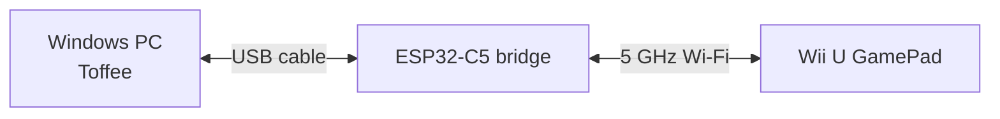

# Setup Guide

This covers release builds. To build from source, see [building.md](building.md).

## What You Need

| Item | Notes |
| --- | --- |
| Windows 10 or 11 PC | |
| Wii U GamePad | No Wii U console is needed. |
| ESP32-C5 board | It must be an **ESP32-C5**: the GamePad only uses 5 GHz Wi-Fi with Nintendo's pairing, and other ESP32 chips have no 5 GHz radio. |
| USB data cable | Some cables only charge. |
| `Toffee.exe` | The bridge firmware is inside it. |

The ESP32-C5 runs as a small access point that the GamePad pairs with; your PC's own Wi-Fi isn't
used.

### Which board

The release firmware is built for and tested on the
[**Waveshare ESP32-C5-Zero**](https://www.waveshare.com/product/esp32-related/boards-kits/esp32-c5/esp32-c5-zero.htm),
and switches on its onboard antenna. Other ESP32-C5 boards should work but are untested; for one
with a different antenna arrangement, such as the ESP32-C5 mini kit, build the firmware with
`CONFIG_ZERO_BOARD` off (see [building.md](building.md#firmware-options)).

Use the board's native **USB Serial/JTAG** port, the one wired straight to the chip rather than
through a USB-to-serial chip. It usually shows in Windows as "USB Serial Device".

## Step 1: Flash the Bridge

Needed once, and again after a Toffee update that changes the firmware.

1. Plug the ESP32-C5 into the PC.
2. Open `Toffee.exe` and go to **Flash ESP**.
3. Check the **Serial port**. If Toffee picked the wrong one, choose another and press **Refresh**.
4. Press **Flash firmware** and confirm. Keep the cable connected.
5. When the card says **Flash complete**, the bridge is restarting.

If flashing can't connect, hold **BOOT**, tap **RESET**, release **BOOT**, then try again.

## Step 2: Connect the Bridge

On **Connect**, pick the bridge's serial port and press **Connect**. The status changes to
**Port open · waiting for GamePad**.

## Step 3: Pair the GamePad

1. Press the recessed red **SYNC** button on the back of the GamePad (a paperclip works).
2. When it asks for a code, enter the four symbols Toffee shows in place of the preview (or that
   `toffee-cli` prints).
3. The status changes to **GamePad ready**.

The bridge keeps the pairing in its flash, so the GamePad reconnects by itself from then on, even
after restarts and firmware updates. Only a full flash erase forgets it.

To pair a different GamePad, or after resetting one, press **Pair new GamePad** on **Connect** (or
run `toffee-cli pair`), then repeat the steps above. Each time, Toffee picks a new code.

## Step 4: Start Streaming

1. On **Connect**, choose a **Source**:
   - **Display capture** streams a whole monitor. It's the smoothest option.
   - **Window capture** streams one window, which has to stay visible: a minimised or covered
     window can't be captured.
   - **Interactive demo** is a test picture for checking the connection.
2. Press **Start stream**.

The stream is 864 × 480 at 59.94 fps, the GamePad's native format; other shapes are letterboxed.
Each picture is coarsened only as much as it needs to arrive in its own frame, so a desktop or
text stays sharp. The session log shows the quantizer in use (`QP`, lower is sharper).

## Features

### Second screen

Turn on **Second screen** at the top of the Connect page. From then on Toffee adds the GamePad
monitor, connects when the bridge is plugged in, captures the monitor and starts streaming once the
GamePad is ready. Touch clicks on that monitor. If you stop or disconnect by hand, Toffee leaves it
stopped until you start again or toggle the switch. It needs the monitor driver below.

### Extra monitor

Turn on **Extra monitor** in Settings, and pick its **Monitor size**. Windows gets a new display to
the right of your others, and Toffee captures it. The first time, **Install the driver** installs
the open-source [Virtual Display Driver](https://github.com/VirtualDrivers/Virtual-Display-Driver)
built into Toffee (Windows asks for permission). Arrange the monitor in Windows **Display settings**.

### Xbox controller for games

Turn on **Show the GamePad to Windows as an Xbox 360 controller** on the Inputs page. Sticks, d-pad
and buttons work, ZL and ZR are the triggers, and game rumble reaches the GamePad. It needs the
free [ViGEmBus](https://github.com/nefarius/ViGEmBus) driver; **Install driver** runs the
installer built into Toffee.

The GamePad has one fixed-strength motor, so strong rumble runs continuously and weak rumble
pulses. Buttons keep their GamePad letters unless you turn on **Xbox button positions** (bottom
button becomes A).

### Touch, motion and emulators

The **Inputs** page shows buttons, sticks, touch and motion live, sets the stick dead zone, and has
a **Rumble** test. **Use the GamePad touchscreen on the PC** makes touch drive the mouse, or real
Windows touch input.

| Motion reading | Axes |
| --- | --- |
| Accelerometer (g) | X along the long edge, Y along the short edge, Z through the screen. Flat and face up reads about -1 on Z. |
| Gyroscope (degrees/s) | X twist about the long edge, Y tilt the top toward or away from you, Z spin flat like a steering wheel. |

**Settings → Input sharing** shares buttons, touch and gyro with any DSU client, such as Cemu;
see [framework.md](framework.md).

## Logs and Bug Reports

Every connection writes a session log to `%LOCALAPPDATA%\Toffee\Toffee\logs`. When you report a
problem, attach the newest log and say which board, GamePad and source you used.

## Troubleshooting

**No serial port is listed.** Use the native USB port and a data cable, then press **Refresh**.
Windows can take a few seconds to show a new port.

**Flashing never connects.** Use the BOOT and RESET steps above, and close anything else using the
port, such as a serial monitor.

**"The bridge did not answer".** The bridge runs firmware from before this version of Toffee. Flash the
current firmware from the **Flash ESP** page.

**A GamePad paired before won't connect.** The bridge may have lost the pairing (a full flash
erase) or the GamePad was reset. Press **Pair new GamePad** and sync again.

**The GamePad never pairs.** Turn it off, start sync again and enter the symbols Toffee shows. Keep it close to
the bridge and away from other 5 GHz Wi-Fi.

**The picture stutters or the stream restarts.** Try turning **Audio** off in Settings. Wi-Fi
interference near the bridge is the usual cause.

**Window capture shows nothing.** Press **Refresh sources**, choose the window again, and make sure
it isn't minimised.

## Known Limits

- Windows only, one GamePad at a time.
- The firmware's Wi-Fi region is Ireland. If 5 GHz channels are restricted differently where you
  live, change it in `firmware/src/network/wifi_setup.cpp` and rebuild.
